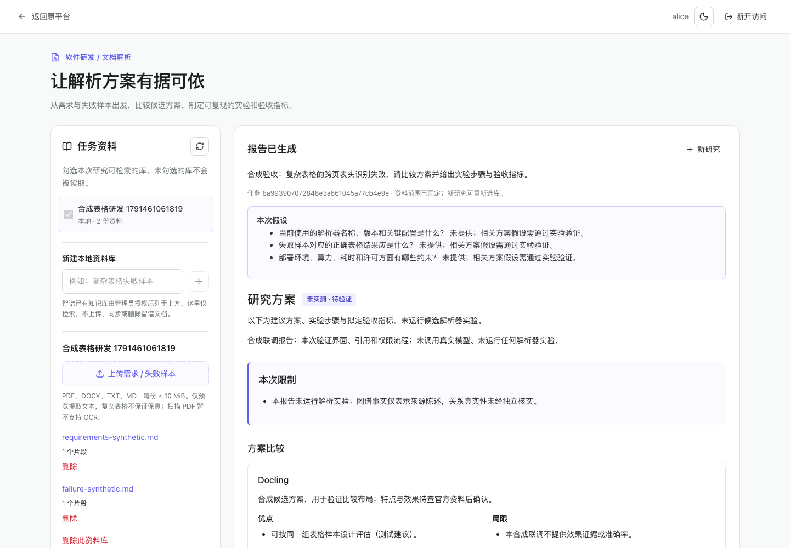

# 文档解析研发入口验收记录

日期：2026-10-08。基线 HEAD：`93d29fb7299d06e691da07a3ae8f42d7a1125338`；本地分支：`feature/document-parsing-research`。

本轮实现同仓库专用入口，保留原系统；没有修改或启动装备研发、武器研发或作战推演业务流程。原 `backend/` 源码最终无差异。没有迁移原数据库、覆盖交付包或推送 GitHub。

## 已通过

| 检查 | 基线 | 修改后实际结果 |
| --- | --- | --- |
| 原前端 `pnpm run test:unit` | 502/502 | 511/511，退出 0 |
| 原前端 `pnpm run lint:check` | 退出 0 | 退出 0 |
| 原前端 `pnpm run build` | 退出 0 | 退出 0，保留原大 chunk 提示 |
| 原仓库 `make check` | 补装测试组后 13/13 | 13/13；架构检查及编译通过，退出 0 |
| 新模块 `pytest document_research/tests -q` | 新模块不存在 | 108/108，退出 0；一条 Starlette TestClient/httpx 弃用提醒 |
| 新模块 Ruff 检查、格式检查 | 新模块不存在 | 均退出 0，13 个 Python 文件格式一致 |
| 真实 loopback HTTP + 合成模型 | 未执行 | 11/11 场景通过 |
| 真实浏览器 + 合成模型 | 未执行 | 10/10 场景通过；已检查浅色、深色、390px截图 |
| 真实公开资料读取 | 未执行 | 显式专用代理下三个官方 README 均成功，记录获取时间与 SHA-256 |
| 启动脚本与专用正常配置 | 未执行 | CLI 初始化、固定 loopback 启动与健康检查通过；正常配置没有合成模型 |

108 项新模块测试由 81 项 Engine/提供商、24 项服务、3 项静态隔离检查组成，不与前几轮通过数累加。

HTTP 场景包括独立认证、两个身份的跨库拒绝、损坏 PDF 可见失败、未同意模型外发拒绝、只用选定资料、空选库不退回全库、伪造来源拒绝、运行中编辑拒绝、取消迟到响应、删除证据后的报告访问拒绝、生成中撤销令牌后丢弃结果。

浏览器验证实际 Vue、HTTP、SQLite 和 Engine。模型响应来自明确标注的本机合成 HTTP 提供商，未调用真实模型。验证三项追问、带假设的计划、比较/步骤/拟定指标、原文陈述/推断、引用定位、刷新恢复、移动布局、取消和原平台凭据隔离。最终预览已停止合成模型，使用单独的正常配置目录。

证据：[HTTP 结果](validation/document-research/http-results.json)、[浏览器结果](validation/document-research/browser-results.json)、[公开读取记录](validation/document-research/public-fetch-final-results.json)。



[深色截图](validation/document-research/dark-report.png) · [移动端截图](validation/document-research/mobile-report.png)

## 失败与修复

最终已执行的检查没有遗留失败；以下失败均保留在工作日志，不能从历史中删除：

| 失败 | 原因与处理 |
| --- | --- |
| Git DNS、HTTP/2、连接超时 | 改用 pinned commit 原始文件并逐个验证 Git SHA；中文路径首次未编码失败，修正后完成 1843 个文件校验。 |
| uv 缓存权限、离线依赖、pytest_asyncio 缺失 | 使用工作区缓存、联网安装，再按项目安装 test group；原 make check 重试通过。 |
| macOS 解析子进程退出 | DATA/AS setrlimit 不可用；Linux 保留硬限制，macOS 用父进程 RSS 监控，保留采样间隔限制。 |
| PATCH/run 覆盖状态 | 独立审查复现，新增并发回归先失败，SQLite 条件事务修复后通过。 |
| 推断附带伪造引文 | 新增反例先失败，修复为所有非空引文匹配来源连续原文，推断仍标待验证。 |
| Ruff 默认规则与格式检查失败 | 修正新文件的 import、嵌套 context、lambda 和格式问题，没有降低 gate。 |
| Chrome 默认沙箱无法启动 | 受审查权限下使用临时浏览器配置验收，无用户浏览器会话读取。 |
| 首次浏览器取消脚本超时 | 脚本新建任务漏勾模型外发同意，产品正确阻止运行；补全同意步骤后通过。 |
| 首次 HTTP 最后一项 403 | 脚本先删除证据再读关联任务，产品正确拒绝；调整检查顺序后通过。 |
| 子代理既有前端测试无法监听 | 环境 EPERM；主代理统一全量 511/511 通过。 |
| 公网提供商全部连接失败 | 本机需要代理；新增显式专用 `network.proxy_url`，默认仍不继承环境代理，真实三源重试通过。 |

## 未验证与边界

- **真实模型及智谱联调：NOT_RUN。** 没有提供相应真实配置，不证明账户权限、配额、真实引用质量或提供商 JSON 兼容性。
- **原完整 Docker 平台栈：NOT_RUN。** 本机无 Docker；原 Agent 全栈启动、PostgreSQL/Redis/Milvus/Neo4j/MinIO/Sandbox 协作未验收。
- **解析方案效果：NOT_RUN。** 没有运行 Docling/PaddleOCR/Unstructured 的解析性能或准确率实验；合成样本不能证明真实复杂表格质量。
- **Linux 资源限制、生产多租户、并发负载、公网部署：NOT_RUN。** macOS RSS 检测不是瞬时硬内存上限。
- **原共享知识图谱/知识检索增强：不在本轮实现中。** 新入口只展示其自己的证据关系，不写共享图谱，不注册共享 Agent 工具。
- 来源编号存在与引句匹配，不等于结论获得充分证据支持；真实报告需要人工复核。
- 基础文本提取不保存原件、不做 OCR、不保证复杂表格结构还原；公开资料仅三个固定官方项目来源，不是全网搜索。
- 取消停止本地结果处理，不能保证远端请求停止或不计费。服务重启后未完任务标记失败。

## 本地复验

在仓库根目录，先按使用说明安装专用依赖和测试工具：

```sh
../document-research-venv/bin/python -m pip install -r document_research/requirements.lock
../document-research-venv/bin/python -m pip install pytest pytest-asyncio ruff
../document-research-venv/bin/python -m pytest document_research/tests -q
../document-research-venv/bin/ruff check document_research
../document-research-venv/bin/ruff format --check document_research
uv sync --project backend --group test
make check
```

前端：

```sh
cd web
pnpm install --frozen-lockfile
pnpm run test:unit
pnpm run lint:check
pnpm run build
```

浏览器与真实 HTTP 过程保留在本机审查目录的 `browser_acceptance.cjs`、`http_acceptance.py`、`synthetic_runtime.py`。它们专用于合成验收，不接入生产启动路径；公开源码中的 `validation/document-research/` 提供可复用的普通软件样本。

## 回滚

本分支有独立本地提交，提交信息为 `feat: add isolated document parsing research workspace`。在合并或继续修改之前，先用 `git log -1` 核对该提交，保留自己的未提交修改，停止专用服务。

若已合并该提交：用 `git revert <该提交SHA>` 生成逆向提交，再按原流程构建/重启前端。若仅试用此干净分支且未追加自己的改动：切回记录的上游基线分支 `main` 即可恢复原源码。不要执行强制 reset/clean。

本轮没有原数据库迁移。专用数据目录位于仓库外，回滚代码不会删除资料或密钥；先独立备份，需要清理时再由使用者明确删除。GitHub 尚未推送，因此本轮没有需要撤回的远端发布。
